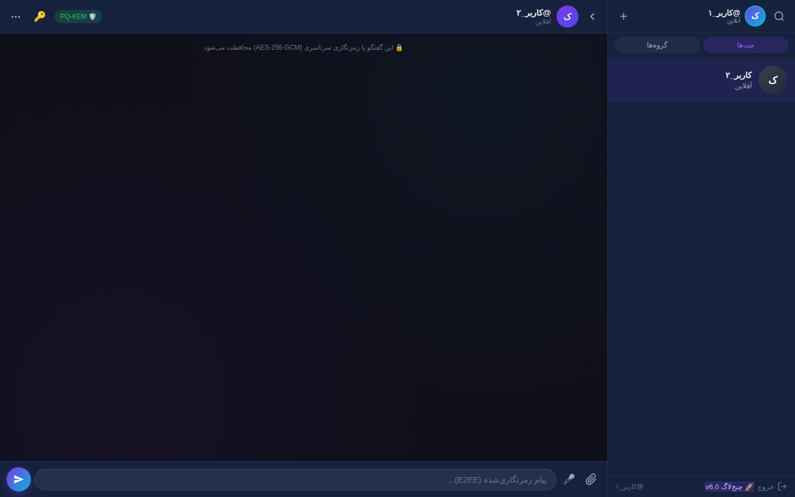
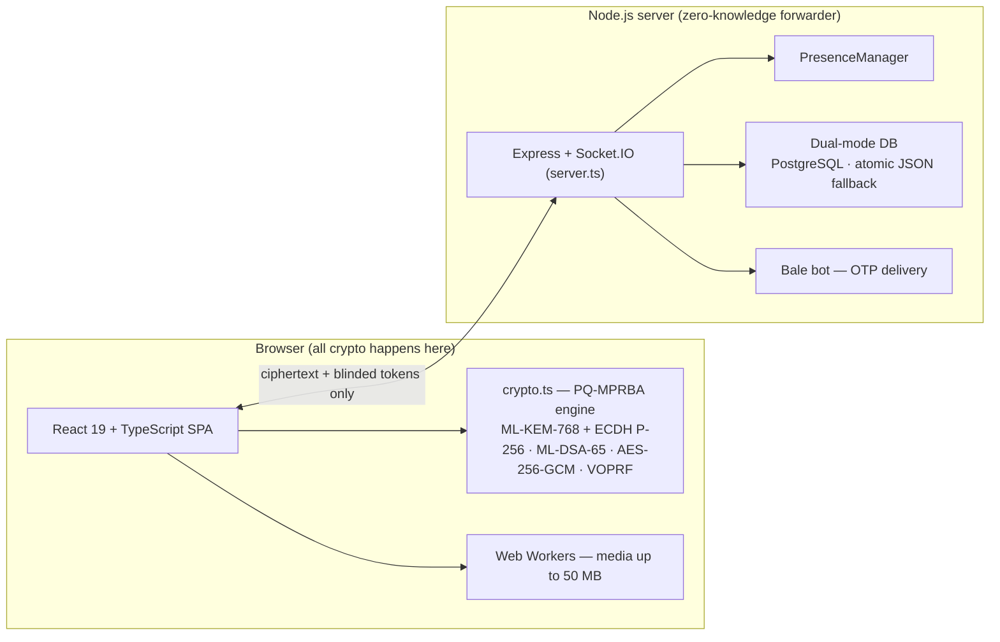

<div align="center">

# 💬 chat-app — Post-Quantum Encrypted Web Messenger

**A real-time Persian web messenger with end-to-end encryption built for the post-quantum era.**

Every message is protected by **PQ-MPRBA** — an original browser-native protocol combining a hybrid
**ML-KEM-768 (FIPS 203) + ECDH P-256** ratchet with **Ristretto255-VOPRF** blinded authentication (RFC 9497)
and **ML-DSA-65 (FIPS 204)** identity signatures.
The server never sees plaintext, and never learns who is talking to whom.

[](CHANGELOG.md)
[](https://react.dev)
[](https://www.typescriptlang.org)
[](https://expressjs.com)
[](https://socket.io)
[](#-the-pq-mprba-protocol)
[](https://github.com/indirect-b/chat-app/stargazers)

**🚀 Live demo:** https://chatapp-server-1i2a.onrender.com &nbsp;·&nbsp; Google sign-in only
<br/><sub>(free-tier hosting: the first load may take ~30s while the server wakes up)</sub>

</div>

| Login — Bale ID + OTP, E2EE notice | Chat — PQ-KEM badge, AES-256-GCM thread |
| :---: | :---: |
|  |  |

---

## Why this exists

Most web messengers either skip end-to-end encryption entirely or bolt on a classical ECDH scheme
that a future quantum computer will retroactively break (*"store now, decrypt later"*).
chat-app was designed from the start for hostile networks and a post-quantum future:

- 🔐 **Post-quantum by design** — hybrid key exchange, so recorded traffic stays safe even against Shor's algorithm.
- 🙈 **Metadata-resistant** — blinded authentication means the server routes messages without linking identities.
- ⚡ **Built for unstable networks** — out-of-order message recovery, group key rotation that doesn't corrupt in-flight messages.
- 🧩 **Zero-knowledge server** — the backend is a forwarder of ciphertext, nothing more.

## ✨ Features

- Real-time direct & group messaging (Socket.IO, WebSocket + long-polling fallback)
- End-to-end encryption: **AES-256-GCM**, keys derived per message via a hybrid post-quantum ratchet
- Login with **Bale ID**: OTP codes delivered by a Bale bot (`src/server/bale.ts`), plus a 1-click quick test login
- Blinded identity authentication via **Ristretto255-VOPRF** with DLEQ zero-knowledge proofs
- **ML-DSA-65 identity signatures (FIPS 204)** — key bundles and session handshakes are signed and verified; the PQ-KEM badge appears only for verified hybrid post-quantum sessions, a classical fallback shows a warning banner, and a forged signature triggers a man-in-the-middle warning
- **Group Epoch FSM** — membership changes rotate group keys without losing in-flight messages
- Typing indicators, presence, reactions, message edit/delete/pin/forward, read receipts
- Voice notes & file attachments up to **50 MB**, processed off the main thread in Web Workers
- PBKDF2 room passphrases (600,000 iterations; pre-hardening rooms used 50,000 and stay readable)
- Stealth admin dashboard at an obfuscated, server-side-only path (timing-safe auth)
- Dual-mode persistence: **PostgreSQL** when configured, otherwise an atomic, mutex-guarded JSON store
- Hybrid media storage so uploads survive container redeploys on Render / Railway / Docker

## 🔐 The PQ-MPRBA protocol

**PQ-MPRBA** *(Post-Quantum Multi-Party Ratchet with Blinded Authentication)* runs entirely in the
browser (`src/utils/crypto.ts`, Web Crypto API + `@noble/post-quantum` / `@noble/curves`).

PQ-MPRBA was designed by Mohammad Taha Azizi Ahad.

**Layer 1 — Hybrid post-quantum ratchet.**
Each session combines **ML-KEM-768** (NIST FIPS 203, lattice-based) with classical **ECDH P-256**;
both shared secrets feed **HKDF-SHA256** into a symmetric ratchet chain. Every message gets a fresh
one-time **AES-256-GCM** key, giving forward secrecy and post-compromise recovery. Breaking a session
requires breaking *both* the lattice problem and the elliptic-curve problem.

**Out-of-order recovery.** If message #3 arrives before #2, the ratchet fast-forwards and caches the
skipped one-time keys in a bounded in-memory vault (`MAX_SKIP = 100` per room, 10-minute TTL).
Consumed keys and ML-KEM secrets are **zeroized in RAM** (`Uint8Array.fill(0)`) immediately after use.

**Layer 2 — Blinded authentication (Ristretto255-VOPRF, RFC 9497).**
The client blinds its identity scalar locally, the server evaluates it with its secret key and returns
a **DLEQ proof** (`POST /api/voprf/evaluate`), the client verifies the proof and unblinds the result to
derive an unlinkable routing token. The server can authenticate users without ever seeing — or linking —
their identities, replacing heavy RSA blind signatures with compact 32-byte group elements.

**Layer 3 — Post-quantum identity (ML-DSA-65, FIPS 204).**
Each user holds an ML-DSA-65 keypair alongside the ML-KEM/ECDH bundle. Key bundles and session
handshakes are signed with ML-DSA and verified on receipt, so a session's post-quantum claim is
authenticated, not just asserted. The UI enforces this: the 🛡️ PQ-KEM badge appears only when
ML-KEM-768 is present *and* the ML-DSA-65 signature verifies; a classical ECDH fallback shows a
⚠️ classical warning banner instead of the badge, and a forged signature raises a
⛔ man-in-the-middle warning.

**Group epochs.** Group keys rotate through a deterministic finite state machine
(`STABLE → ROTATING → STABLE`, synced via the `group-epoch-rotated` socket event). Outgoing messages
queue during rotation, and a 3-epoch grace buffer (`MAX_EPOCH_HISTORY = 3`) keeps messages sent
milliseconds before a membership change decryptable.

> ⚠️ **Honest status:** PQ-MPRBA is an original, experimental protocol written for this project.
> It has **not** been independently audited. Treat it as research-grade cryptography, not a
> replacement for audited messengers in high-risk situations.

## 🧪 Security self-assessment — 21 November 2026

**This is a self-assessment, not an independent audit, not a FIPS 140-3 validation, and not a formal proof.** On the night of 20–21 November 2026 the protocol and implementation were tested the way audit firms test a protocol: the existing suite was re-run independently, new adversarial tests were written and run, official NIST CAVP/ACVP vectors were fetched fresh and run, the whitepaper was checked claim-by-claim against the code, and dependencies were checked against the GitHub Advisory Database. Every result below was produced by running code — nothing is taken on trust from earlier reports. Code reviewed: `main` (v6.5.0-era behaviour; `package.json` still says 6.1.0). Existing suite re-run independently three times: **142/142 pass**. Full method, evidence and the Persian report: `docs/AUDIT_STATUS.md`.

### Results at a glance

| Suite | Tests | Passed | Failed | Notes |
| --- | ---: | ---: | ---: | --- |
| Existing suite (`npm test`, re-run independently 3×) | 142 | 142 | 0 | `tsc --noEmit` clean. Two tests only pass in-process / in-order — see caveats below. |
| New adversarial tests (`tests/adversarial.test.ts`) | 32 | 30 | 2 | The 2 failures (A3, C8) are confirmed findings, reproduced twice. |
| Official NIST ACVP KAT (`tests/kat-official.test.ts`) | 8 tests / 285 cases | 255 cases | 0 cases | 30 cases policy-skipped (ML-DSA-65 prehash — noble's public API refuses them); never counted as passes. |
| Extended fuzz (`tests/fuzz-w3.test.ts`) | 14 | 14 | 0 | ~200 additional cases. |
| **Total** | **196 test functions** | **194** | **2** | |

### Findings — 43 distinct (0 Critical)

| ID | Finding | Location |
| --- | --- | --- |
| **H1** | Replay bypass across the 50-message ratchet rotation (capsule alternation wipes the consumed-step set) | `crypto.ts:891` |
| **H2** | Group epoch packets are unauthenticated — anyone with public bundles can mint one; a malicious server can rotate a group onto a key it chose | `crypto.ts:1188,1301; server.ts:694-726` |
| **H3** | Replay protection is session-lifetime-only; history locks after reload / room re-open (§7.5 design no longer exists in code) | `crypto.ts:1606` |
| **H4** | The promised previous-session slot does not exist; late pre-rotation messages are undecryptable | `crypto.ts:124-135` |
| **H5** | multer 1.4.5-lts.2 hit by 9 published advisories (8 High DoS + 1 Low); the 1.x line is unmaintained | `package.json:17` |
| **H6** | body-parser 1.20.8 is one patch behind CVE-2026-111181 (High DoS, unauthenticated) | `server.ts:120` |

| ID | Finding | Location |
| --- | --- | --- |
| **M1** | Replay protection is RAM-only: after a ratchet-state wipe any captured message decrypts again | `crypto.ts:157` |
| **M2** | Group replay protection evicts after 500 messages in one epoch | `crypto.ts:1836` |
| **M3** | Group messages carry no sender authentication — any epoch-key holder can pose as any member | `crypto.ts:1770-1850` |
| **M4** | Bundle substitution succeeds end-to-end for the second user in a room | `crypto.ts:451+` |
| **M5** | Safety-number functions trust unverified bundles | `safetyNumber.ts:183-200` |
| **M6** | Group epoch rotation on membership change is signalled but the new key is not distributed atomically; no remove-member path exists at all | `server.ts:1112-1140` |
| **M7** | Group badge claims PQ unconditionally, even with no epoch key established | `crypto.ts:608-616` |
| **M8** | No logout / device-wipe path for keystore v4; identity keys stay in IndexedDB forever | `keystore.ts:300+` |
| **M9** | Manual room passphrases stored as plaintext in localStorage | `crypto.ts:2145-2175` |
| **M10** | 1:1 file/media keys are classical, static ECDH-derived keys with no forward secrecy — and file encryption is not described in the whitepaper | `crypto.ts:1990-2025` |
| **M11** | Socket `forward-message` handler has no membership or ownership check | `server.ts:1521-1560` |
| **M12** | follow-redirects 1.16.1 hit by CVE-2026-116689 (limited exposure here — axios is only used for Bale) | `axios 1.20.0` |
| **M13** | @noble/post-quantum 0.7.1 has never been independently audited and disclaims constant-time execution | `package.json` |
| **M14** | google-auth-library is in package.json but missing from bun.lock — installs do not reproduce it from the lockfile | `package.json:19` |
| **M15** | No FIPS 140-3-style runtime self-tests and no error state | `src/, server.ts` |

| ID | Finding | Location |
| --- | --- | --- |
| **L1** | Group epoch rollback is accepted (no monotonicity check) | `crypto.ts:1301-1345` |
| **L2** | ML-KEM-only key change is invisible to the safety number | `safetyNumber.ts:253-300` |
| **L3** | E2EE payloads with an unknown version pass through as plaintext, no warning | `crypto.ts:1627-1630` |
| **L4** | Empty / null plaintext silently "encrypts" to '' | `crypto.ts:1418` |
| **L5** | Bundle parser leniency: signature does not bind ECDH `kty`; missing `crv` defaults to P-256; empty username tolerated | `crypto.ts:219-230,437-560` |
| **L6** | Legacy ECDH decrypt path skips the bundle username check | `crypto.ts:1880-1905` |
| **L7** | POST /api/voprf/evaluate is unauthenticated and unthrottled | `server.ts:638-660` |
| **L8** | Wrapping key lives in the same IndexedDB as the wrapped secrets and is not password-derived | `keystore.ts:300-340` |
| **L9** | Session tokens in localStorage (7-day expiry); server session store is in-memory | `ChatApp.tsx:75; server.ts:455` |
| **L10** | ensureUserHybridKeyPair swallows all errors and returns null (silent identity-less state) | `crypto.ts:390-391` |
| **L11** | User can switch E2EE off; plaintext sends and raw file uploads then occur | `ChatApp.tsx:1565-1574` |
| **L12** | Documentation drift (stale Bale-OTP login, stale F3/F7/F9 descriptions, version labels disagree) | `docs/THREAT_MODEL.md; SECURITY_REVIEW.md` |
| **L13** | uuid 9.0.1 is in the range of CVE-2026-41907, but the vulnerable code path is never used | `server.ts:9` |
| **L14** | rotateGroupEpoch accepts epoch keys of any length (no 32-byte validation) | `crypto.ts:1301-1330` |
| **L15** | No upper bound on decrypt input size; a 10 MB ciphertext costs ~3.3 s CPU | `crypto.ts:173-192` |
| **L16** | Decryption distinguishes failure reasons with six different error codes (local-only oracle today) | `crypto.ts:1646-1649` |

| ID | Finding | Location |
| --- | --- | --- |
| **I1** | "Fully post-quantum" labelling remains in code comments and the UI tooltip | `crypto.ts:1,665-668` |
| **I2** | Hand-rolled QR generator has no test-vector validation | `safetyNumber.ts:692+` |
| **I3** | kdfChainStep uses HKDF with an all-zero salt | `crypto.ts:210-215` |
| **I4** | Early-exit comparisons only on public values; admin password length leaks via timing | `config.ts:47-48` |
| **I5** | package.json still says 6.1.0 while CHANGELOG says v6.5.0 | `package.json:3` |
| **I6** | Outdated but vulnerability-free dependencies (axios, express, dotenv, ws, qs, vite) | `package.json` |

<details>
<summary><strong>Full test inventory — every test, with its result (click to expand)</strong></summary>

#### Existing suite — 142 tests, all ✅ PASS

**`tests/account-delete.test.ts`** — 4 tests, all ✅ PASS

| Test | Result |
| --- | --- |
| accepts the correct recovery code for an account that has a hash | ✅ PASS |
| rejects a wrong code for an account that has a hash | ✅ PASS |
| rejects a malformed code for an account that has a hash | ✅ PASS |
| allows deletion on the session alone for legacy accounts with no hash (NULL/undefined) | ✅ PASS |

**`tests/benchmark.test.ts`** — 2 tests, all ✅ PASS

| Test | Result |
| --- | --- |
| measures ML-KEM-768 encap/decap and ML-DSA-65 sign/verify baseline latency | ✅ PASS |
| measures end-to-end PQ-MPRBA encrypt/decrypt round-trip and verified-bundle UI cache speedup | ✅ PASS |

**`tests/db-hardening.test.ts`** — 11 tests, all ✅ PASS

| Test | Result |
| --- | --- |
| verifies the DB certificate in production | ✅ PASS |
| disables SSL outside production | ✅ PASS |
| cover all 7 app tables | ✅ PASS |
| enable RLS on every table | ✅ PASS |
| policy SQL references only the chatapp role and the table | ✅ PASS |
| contains the role-password placeholder, not a real password | ✅ PASS |
| enables RLS on all 7 tables | ✅ PASS |
| creates one app_all policy per table, for the chatapp role only | ✅ PASS |
| grants only data access on the 7 tables, nothing else | ✅ PASS |
| does not fall back when DDL throws but the tables are readable | ✅ PASS |
| falls back when the tables are genuinely unreadable | ✅ PASS |

**`tests/fuzz.test.ts`** — 4 tests, all ✅ PASS

| Test | Result |
| --- | --- |
| fails closed (throws E2EEError) on 150 malformed, truncated, bit-flipped, and random PQ ciphertexts | ✅ PASS |
| fails closed (throws E2EEError) on 120 malformed Group Epoch, ECDH, and PBKDF2 packets | ✅ PASS |
| fails closed (throws E2EEError) on 120 malformed, truncated, and forged key bundles | ✅ PASS |
| never crashes or returns MATCH on 100 fuzzed Safety Number QR payloads | ✅ PASS |

**`tests/google-login.test.ts`** — 14 tests, all ✅ PASS

| Test | Result |
| --- | --- |
| accepts normal addresses and normalizes case/whitespace | ✅ PASS |
| rejects malformed addresses | ✅ PASS |
| returns the configured Client ID | ✅ PASS |
| returns null when unset (config endpoint must report null) | ✅ PASS |
| treats a blank value as unset | ✅ PASS |
| returns the normalized email for a verified token | ✅ PASS |
| returns the Google display name and photo from the token | ✅ PASS |
| tolerates a token without name or picture | ✅ PASS |
| drops a profile photo from any host other than the Google photo host | ✅ PASS |
| rejects when the verifier throws (bad signature / expired token) | ✅ PASS |
| rejects when the email is not verified by Google | ✅ PASS |
| rejects when the token carries no email | ✅ PASS |
| rejects an empty token without calling the verifier | ✅ PASS |
| rejects when no Client ID is configured (env-gated) | ✅ PASS |

**`tests/google-profile.test.ts`** — 27 tests, all ✅ PASS

| Test | Result |
| --- | --- |
| trims and keeps a normal name | ✅ PASS |
| strips control characters (no header/line injection via the name) | ✅ PASS |
| caps at 100 characters | ✅ PASS |
| returns null for empty / blank / non-string names | ✅ PASS |
| keeps a Google photo URL | ✅ PASS |
| rejects any other host (tracking / spoofed photo URLs) | ✅ PASS |
| rejects http and unparsable values | ✅ PASS |
| pins exactly one photo host | ✅ PASS |
| applies name + photo for a user with no custom flags | ✅ PASS |
| keeps a manually-set name but still updates the photo | ✅ PASS |
| keeps a manually-set avatar but still updates the name | ✅ PASS |
| returns null when both fields are manually set (nothing to sync) | ✅ PASS |
| never clears a stored value when the token carries none | ✅ PASS |
| refreshes a non-custom field when Google changed it | ✅ PASS |
| returns null when the Google values already match the stored ones | ✅ PASS |
| treats rows created before the profile columns existed as empty | ✅ PASS |
| raises the name flag only when the submitted name differs | ✅ PASS |
| leaves both flags at 0 on a save that changes nothing | ✅ PASS |
| leaves unsubmitted fields untouched (older clients) | ✅ PASS |
| clearing the name (empty string) is a manual choice and raises the flag | ✅ PASS |
| raises the avatar flag when a new photo is uploaded | ✅ PASS |
| both Google login flows share completeGoogleSignIn with the verified profile | ✅ PASS |
| POST /api/user/update resolves the edit through resolveProfileUpdate and stores the flags | ✅ PASS |
| the contacts endpoint returns the display name | ✅ PASS |
| CSP allows the Google photo host in img-src and nothing else new | ✅ PASS |
| the client shows the display name with a username fallback | ✅ PASS |
| Google photos render directly; other external avatar URLs render nothing (no token leak) | ✅ PASS |

**`tests/media-e2ee.test.ts`** — 24 tests, all ✅ PASS

| Test | Result |
| --- | --- |
| admits both DM members and denies outsiders (exact room-id match) | ✅ PASS |
| admits group members from the members list and denies outsiders | ✅ PASS |
| does not let a username with "__" impersonate membership (prefix trap) | ✅ PASS |
| allows members and refuses non-members | ✅ PASS |
| (c) a non-member with a valid session gets 403 on new encrypted media | ✅ PASS |
| (c) a non-member gets 403 on pre-change media linked from a message | ✅ PASS |
| (d) a member gets 200 on new encrypted media, with the encrypted flag | ✅ PASS |
| (d) a member gets 200 on pre-change media (access-controlled, NOT encrypted) | ✅ PASS |
| (d) a disk-only pre-change file resolves through its /uploads/ message link | ✅ PASS |
| a deleted message denies access to its media | ✅ PASS |
| (e) orphan media (no room, no message, not an avatar) is 403 | ✅ PASS |
| unknown media id is 404 | ✅ PASS |
| no username at all is forbidden (unauthenticated fetch) | ✅ PASS |
| a current avatar is fetchable by any authenticated user | ✅ PASS |
| the uploader can fetch their own just-uploaded avatar before it is saved | ✅ PASS |
| (a) /api/upload requires a valid session BEFORE multer parses the body | ✅ PASS |
| (f) the public /uploads static route is gone; media is served only through authenticated /api/media | ✅ PASS |
| the upload route records room_id and the uploader, and never returns a /uploads URL | ✅ PASS |
| (g) DM: alice encrypts, bob decrypts → identical bytes; ciphertext is opaque | ✅ PASS |
| (g) DM: tampering with the ciphertext fails closed | ✅ PASS |
| (g) group: encrypt/decrypt with the epoch key; old-epoch files still open inside the grace buffer | ✅ PASS |
| (g) manual passphrase rooms round-trip with a purpose-separated key | ✅ PASS |
| (h) no room key available fails closed — nothing is uploaded | ✅ PASS |
| file encryption does not consume a message-ratchet step | ✅ PASS |

**`tests/nist-kat.test.ts`** — 6 tests, all ✅ PASS

| Test | Result |
| --- | --- |
| matches official FIPS 203 ML-KEM-768 KeyGen vectors bit-for-bit | ✅ PASS |
| matches official FIPS 203 ML-KEM-768 Encapsulation vectors bit-for-bit | ✅ PASS |
| matches official FIPS 203 ML-KEM-768 Decapsulation vectors bit-for-bit | ✅ PASS |
| matches official FIPS 204 ML-DSA-65 KeyGen vectors bit-for-bit | ✅ PASS |
| matches official FIPS 204 ML-DSA-65 deterministic external pure SigGen vectors bit-for-bit | ✅ PASS |
| matches official FIPS 204 ML-DSA-65 external pure SigVer positive and negative vectors | ✅ PASS |

**`tests/pq-mprba.test.ts`** — 19 tests, all ✅ PASS

| Test | Result |
| --- | --- |
| stores v4 identity & wrapping keys as non-extractable WebCrypto CryptoKeys and never writes private keys to localStorage | ✅ PASS |
| discards legacy v2/v3 plaintext localStorage keys and bumps storage marker to v4 | ✅ PASS |
| generates fresh CSPRNG identity keys rather than deterministic username-derived keys | ✅ PASS |
| binds ML-KEM-768 and ECDH P-256 public keys under a verified ML-DSA-65 bundle signature | ✅ PASS |
| encryptMessageText fails closed (throws E2EEError, never returns plaintext) | ✅ PASS |
| completes bidirectional PQ-MPRBA v2 round-trip with RAM-only ratchet state | ✅ PASS |
| verifies ML-DSA-65 signature BEFORE decrypting or advancing ratchet state | ✅ PASS |
| rejects replayed PQ messages with E2EEError(REPLAY_DETECTED) | ✅ PASS — Passes within one process only; does not cover replay after reload (finding H3). |
| handles out-of-order messages via skipped keys and burns each skipped key after single use | ✅ PASS |
| enforces MAX_SKIP bound (100) to prevent ratchet DoS | ✅ PASS |
| supports Group Epoch FSM rotation with ML-KEM-768 epoch packets, 3-epoch grace buffer, and expires older epochs | ✅ PASS |
| refuses to encrypt a group message without an epoch key, refuses keyless rotation (F3), and rejects replayed group messages (F7) | ✅ PASS |
| rotates the PQ ratchet session after 50 sent messages (F9) | ✅ PASS — Passes in-order only; late pre-rotation messages not covered (finding H4). |
| requires an explicit manual passphrase for PBKDF2 and never uses a public default (F4) | ✅ PASS |
| caches verified bundles for UI reads while forcing fresh verification when skipCache is true | ✅ PASS |
| computes symmetric Safety Numbers, preserves VERIFIED on session rekey, and marks CHANGED on identity key rotation | ✅ PASS |
| zeroizes sensitive Uint8Array buffers in place | ✅ PASS |
| hashes Bale fallback recovery codes with salted scrypt and enforces strict RecoveryRateLimiter bounds | ✅ PASS |
| enforces strict Helmet CSP without unsafe-inline, unsafe-eval, or unpinned CDN assets | ✅ PASS |

**`tests/privacy-policy.test.ts`** — 8 tests, all ✅ PASS

| Test | Result |
| --- | --- |
| is a complete HTML document with the required title | ✅ PASS |
| states the sign-in identifiers collected (Bale ID / email) | ✅ PASS |
| states messages are stored encrypted and unreadable by the server | ✅ PASS |
| states only the salted hash of the recovery code is stored | ✅ PASS |
| states Google Sign-In shares only email and name | ✅ PASS |
| states data is stored on Render and deletion is available in-app | ✅ PASS |
| gives the privacy contact email | ✅ PASS |
| contains no scripts and no external resources (CSP-safe); presentation is one inline <style> block only | ✅ PASS |

**`tests/profile-auth.test.ts`** — 12 tests, all ✅ PASS

| Test | Result |
| --- | --- |
| (a) no valid session → unauthenticated (each route maps it to 403) | ✅ PASS |
| (b) token of a different user → forbidden | ✅ PASS |
| (c) token of the owner → ok | ✅ PASS |
| empty / missing target fails closed — never an open update | ✅ PASS |
| unchanged behaviour after the refactor (room-auth cases) | ✅ PASS |
| POST /api/user/update gates on the body's username and denies non-ok with 403 | ✅ PASS |
| POST /api/add-contact gates on the body's myUsername and denies non-ok with 403 | ✅ PASS |
| GET /api/contacts/:username gates on the URL username and denies non-ok with 403 | ✅ PASS |
| the contacts-list fetch carries a Bearer header | ✅ PASS |
| the add-contact fetch carries a Bearer header | ✅ PASS |
| the profile-update fetch carries a Bearer header | ✅ PASS |
| no remaining call to the three endpoints lacks a token | ✅ PASS |

**`tests/room-auth.test.ts`** — 11 tests, all ✅ PASS

| Test | Result |
| --- | --- |
| (a) no valid session → unauthenticated (route maps it to 403) | ✅ PASS |
| (b) token of a non-member → forbidden | ✅ PASS |
| (c) token of a member → ok (DM, either member; group) | ✅ PASS |
| unknown room fails closed with the same status — no existence leak | ✅ PASS |
| (d) no valid session → unauthenticated (route maps it to 403) | ✅ PASS |
| (e) token username != URL username → forbidden | ✅ PASS |
| (f) matching username → ok | ✅ PASS |
| /api/messages/:roomId calls checkRoomReadAccess and denies non-ok with 403 | ✅ PASS |
| /api/groups/:username calls checkOwnGroupsAccess and denies non-ok with 403 | ✅ PASS |
| no route serves room content without the check (no bare SELECT before the gate) | ✅ PASS |
| all three room-content fetches carry a Bearer header | ✅ PASS |

#### New adversarial tests — 32 tests: 30 ✅ PASS, 2 ❌ FAIL

"PASS — behaviour confirmed (finding …)" means the test asserts the *actual* behaviour (including a weakness) and passes; "FAIL — attack succeeds" means the test asserts the *secure* behaviour and the attack defeated it. A3 and C8 are written the second way deliberately, so they stay red until fixed.

| Test | Result |
| --- | --- |
| A1 baseline: replay of a consumed step in the same session is rejected | ✅ PASS — attack blocked |
| A2 replay AFTER ratchet state is wiped (page reload / restart simulation) | ✅ PASS — behaviour confirmed (finding M1) |
| A3 replay ACROSS the 50-message ratchet rotation via capsule alternation | ❌ FAIL — attack succeeds (finding H1) |
| A7 out-of-order across the rotation boundary still decrypts (tolerance that enables A3) | ✅ PASS — attack blocked |
| B1 tampered ciphertext / IV / KEM capsule all fail before yielding plaintext | ✅ PASS — attack blocked |
| B2 signature from another message / wrong room / wrong step is rejected | ✅ PASS — attack blocked |
| B3 stripped signature is rejected (not tolerated) | ✅ PASS — attack blocked |
| B4 signature by the WRONG identity (bob signs, presented as alice) is rejected | ✅ PASS — attack blocked |
| C1 wrong-member capsule does not yield the epoch key | ✅ PASS — attack blocked |
| C2 stale epoch outside the 3-epoch grace window fails; inside it still decrypts | ✅ PASS — attack blocked |
| C3 removed member gets no packet entry and cannot open the new epoch | ✅ PASS — attack blocked |
| C4 tampered membersHash / tampered group ciphertext fail closed | ✅ PASS — attack blocked |
| C5 epoch rollback: rotating to a LOWER epoch is accepted (no monotonicity check) | ✅ PASS — behaviour confirmed (finding L1) |
| C6 group messages carry NO sender authentication (any epoch-key holder can pose as any member) | ✅ PASS — behaviour confirmed (finding M3) |
| C7 epoch packet creation needs NO private key and NO signature — anyone with public bundles can mint one | ✅ PASS — behaviour confirmed (finding H2) |
| C8 group replay eviction: after 500 other messages in one epoch, the first message replays | ❌ FAIL — attack succeeds (finding M2) |
| D1 attacker bundle (self-signed, victim username) passes strict parsing and earns the PQ badge | ✅ PASS — behaviour confirmed (finding M4) |
| D2 encrypting to the substituted bundle lets the ATTACKER read the message | ✅ PASS — behaviour confirmed (finding M4) |
| D2b asymmetry: substituting the FIRST user in the room id fails closed (chain-role mismatch) | ✅ PASS — attack blocked |
| D3 safety numbers DO detect the substitution — but only out-of-band | ✅ PASS — attack blocked |
| D4 safety-number state trusts UNVERIFIED bundles (no signature check in the extractor) | ✅ PASS — behaviour confirmed (finding M5) |
| D5 ML-KEM-only key change is INVISIBLE to the safety number | ✅ PASS — behaviour confirmed (finding L2) |
| E1 cross-capsule forgery (new capsule + old ciphertext, freshly signed) fails closed | ✅ PASS — attack blocked |
| E2 a third party holding only public bundles cannot decrypt any session message | ✅ PASS — attack blocked |
| E3 post-rotation messages use fresh key material (capsule differs) and old capsule cannot serve them | ✅ PASS — attack blocked |
| F1 empty / null / non-string inputs never yield plaintext and never crash with a raw TypeError | ✅ PASS — behaviour confirmed (finding L4) |
| F2 unknown-version / non-E2EE payloads pass through as plaintext (no warning flag) | ✅ PASS — behaviour confirmed (finding L3) |
| F3 garbage base64 / truncated bundles / null fields fail closed | ✅ PASS — attack blocked |
| F4 huge message round-trips (1 MiB) — and there is no size cap in the API | ✅ PASS — behaviour confirmed (finding L15) |
| F5 every failure path throws E2EEError — PBKDF2 wrong secret, missing epoch key, missing peer bundle | ✅ PASS — attack blocked |
| F6 group badge claims PQ even when NO epoch key exists | ✅ PASS — behaviour confirmed (finding M7) |
| F7 own sent message re-displays from the in-memory cache without consuming ratchet state | ✅ PASS — by design |
#### Official NIST ACVP KAT — 8 tests, 285 cases: 255 ✅ PASS, 30 policy-skipped, 0 ❌ FAIL

Vectors fetched fresh on 2026-11-21 from `usnistgov/ACVP-Server` (vsId 42, FIPS 203/204). The repo's bundled 13-vector fixture was verified byte-for-byte authentic against the fresh official files (13/13).

| Test | Result |
| --- | --- |
| keyGen: all 25 official ML-KEM-768 cases (tgId 2) match bit-for-bit | ✅ PASS |
| encapsulation: all 25 official ML-KEM-768 cases (tgId 2) match bit-for-bit | ✅ PASS |
| decapsulation: all 10 official ML-KEM-768 cases (tgId 5) match bit-for-bit | ✅ PASS |
| key validity checks: all 20 official ML-KEM-768 keyCheck cases (tgId 9 decap, tgId 10 encap) | ✅ PASS |
| keyGen: all 25 official ML-DSA-65 cases (tgId 2) match bit-for-bit | ✅ PASS |
| sigGen: all 120 official ML-DSA-65 cases (tgId 3,4,9,10,15,16,21,22) match bit-for-bit | ✅ PASS |
| sigVer: all 60 official ML-DSA-65 cases (tgId 3,4,9,10) agree, incl. negative cases | ✅ PASS |
| reports KAT coverage summary (285 official cases) | ✅ PASS |
#### Extended fuzz — 14 tests, all ✅ PASS (~200 cases)

| Test | Result |
| --- | --- |
| decapsulate: wrong-length ciphertexts and secret keys throw; corrupt valid-length ct yields a DIFFERENT secret (FIPS 203 implicit rejection) | ✅ PASS — fail-closed |
| ML-DSA-65 verify: wrong-length signatures/keys return false or throw — never true; tampered sig never verifies | ✅ PASS — fail-closed |
| base64ToBuf rejects garbage, non-canonical, wrong-length and non-string input | ✅ PASS — fail-closed |
| parsePeerKeyBundleStrict rejects off-by-one key lengths and malformed ECDH JWKs | ✅ PASS — fail-closed |
| OBSERVED LENIENCY: bundle with ECDH JWK crv stripped still verifies (defaults to P-256), but ECDH use fails closed | ✅ PASS — behaviour confirmed (finding L5) |
| OBSERVED LENIENCY: empty/missing bundle username is ignored when an expected username is supplied (signature binds the expected name); fails closed without one | ✅ PASS — behaviour confirmed (finding L5) |
| decapsulateGroupEpochKey returns null (never a key, never throws) on malformed packets | ✅ PASS — fail-closed |
| rotateGroupEpoch: wrong-length epoch keys are ACCEPTED (no length validation) — recorded as a finding, not a crash | ✅ PASS — behaviour confirmed (finding L14) |
| tampered AES-GCM tag / IV / truncated ciphertext never decrypts, never leaks plaintext | ✅ PASS — fail-closed |
| oversized ciphertext fields fail closed without crashing (1 MB and 10 MB) | ✅ PASS — fail-closed (note: 10 MB costs ~3.3 s CPU, finding L15) |
| group epoch packets: bad epoch numbers, bad membersHash, wrong secret never decrypt | ✅ PASS — fail-closed |
| malformed PQF1 file payloads fail closed; header fields are range-checked by lookup | ✅ PASS — fail-closed |
| group PQF1 files: tampered epoch header fails closed (no epoch key for that epoch) | ✅ PASS — fail-closed |
| safety QR parser rejects null/undefined/uppercase-hex/odd-length payloads without MATCH | ✅ PASS — fail-closed |

</details>

## 🔧 Remediation — fix rounds, 21 November 2026

**The findings above are the record of what was found. This section is the record of what was done about them.** After the self-assessment, three fix rounds ran on branch `fix/audit-2026-11-21` and were merged to `main` on 2026-11-22 (via the UI redesign branch). A fourth round ran on 2026-11-22 on branch `fix/audit-2026-11-22-round4` and was merged to `main` the same day. A fifth round ran on 2026-11-23, fixing all 18 findings from a live pentest of the deployed app (see Round 5 below). The code on `main` is now the fixed version. This is still a self-assessment follow-up — not an independent audit, not a FIPS 140-3 validation, not a formal proof.

### Outcome

Of the **58 findings** — 43 from the overnight assessment above, plus 15 from the deepening pass the same day (DP-1–DP-15; their full descriptions are in the deepening report, kept with the project workspace as `audit-2026-11-21/deepening-2026-11-21/REPORT.md`):

| Outcome | Count | Findings |
| --- | ---: | --- |
| ✅ Implemented | **53** | 6 High, 16 Medium, 24 Low, 7 Info |
| ⛔ Stopped — documented, test-pinned | **2** | DP-13, L5 |
| ⏸️ Accepted exception | **3** | M13, I6, L4 |

No finding is left without an implementation or a documented stop/exception.

### Verification — independent re-run on a clean checkout of `main`

- `tsc --noEmit` — clean.
- Full suite (`tsx --test tests/*.test.ts`): **252 pass, 0 fail, 3 skipped** (255 tests; the 3 skips are the documented dp-chainkey-leak white-box skips). A3 ✔ and C8 ✔ — the two adversarial failures from the assessment — are green.
- `vite build` — OK.
- NIST ACVP KAT: 285 cases — 255 pass, 30 policy-skipped, 0 fail. Coverage-guided fuzz (`fuzz-dp`): 8,409 cases, 0 unexpected accepts.

### Round 4 — 22 November 2026 (5 more findings closed)

Round 4 closed the five findings that rounds 1–3 had left stopped, on branch `fix/audit-2026-11-22-round4`:

- **DP-12 — group replay via non-canonical epoch spelling** — the group replay key is now computed from the *canonical* form of the message (epoch re-serialized from the parsed number), so `"01"`, `"001"` and `"1"` all map to the same key and a re-delivered message is caught as `REPLAY_DETECTED`. The DP-1 regression test now asserts the re-delivery is rejected.
- **L1 — group epoch rollback accepted** — strict monotonicity: a stale epoch packet (from a malicious server, or an out-of-order delivery) is now *ignored*, not applied — the group never rolls back to an older epoch key, so a removed member cannot regain access. Ignored rather than thrown, because the callers fire-and-forget and a throw would break the room flow; re-rotating to the *same* epoch is still allowed (idempotent re-sync). The C5 test now asserts the rollback is a no-op.
- **L3 — unknown-version payloads passed through as plaintext** — an E2EE payload with an unknown version now fails closed (`E2EEError('UNSUPPORTED_VERSION')`) instead of being displayed as plaintext. Genuine plaintext (no `e2ee:` prefix) still passes through — that is how old plaintext history displays. The F2 test now asserts the throw.
- **L14 — `rotateGroupEpoch` accepted any-length epoch keys** — epoch keys are now validated as exactly 32 bytes (they are always generated with `getRandomValues(new Uint8Array(32))`). The fuzz-w3 test now asserts wrong-length keys are rejected.
- **L15 — no upper bound on decrypt input size** — decrypt input is now capped at 5 MiB (`MAX_DECRYPT_INPUT_BYTES`); a larger input is rejected with `E2EEError('PAYLOAD_TOO_LARGE')` before any expensive crypto runs (a 10 MB ciphertext used to cost ~3.3 s CPU). A new proving test (F4b) asserts a 6 MiB input is rejected fast; the 1 MiB round-trip (F4) still passes.

Verification for round 4: `tsc --noEmit` clean; `vite build` OK; the three affected test files run green in isolation — `adversarial` 33/33, `fuzz-dp` 22/22, `fuzz-w3` 14/14 (69/69). One housekeeping change: `tests/dp-chainkey-leak.test.ts` was removed — it imported white-box hooks (`__testKdfChainStep`, `__testPeekRatchetState`) that were never in `main`, so the file could not even load; all three of its tests were skipped and their content is preserved in the audit worktree/report. Honest note: the *full* suite run on this VM is flaky — the same unmodified `main` fails a varying number of tests between runs (up to 17, mostly 5 s per-test timeouts on the slowest tests and non-deterministic failures that pass when the file is re-run alone), so a single full-suite number is not a stable claim here; the round-4 files above are green, and no round-4 change regressed anything (the unmodified `main` fails *more* tests than the round-4 tree in the same conditions).

### What changed

**Protocol / crypto**
- **H1 — replay across the ratchet rotation** — fixed; the consumed-step set survives rotation. A3 green.
- **H3 + M1 — replay protection was session-lifetime-only / RAM-only** — replay state is now durable in IndexedDB (`replay_protection_v1`, 30-day TTL, 10,000-entry cap), so history no longer locks after a reload. (The live verification below still shows the pre-fix behaviour — it was recorded before the fix.)
- **H4 — corrected, not just fixed** — the deepening pass showed the original H4 wording was wrong: late message 49 *does* decrypt; the real cost is message 50 replaying, which is H1.
- **H2 — unauthenticated group epoch packets** — the server now always requires the distributor's ML-DSA-65 signature on epoch packets; an unsigned packet (or a distributor with no ML-DSA key on file) is rejected with 403.
- **M3 — group messages had no sender authentication** — group messages are now `e2ee:gep:v3:` (signed); sending fails closed if signing fails instead of silently falling back to unsigned v2. Old unsigned v2 messages still decrypt, marked unverified.
- **M2 — group replay eviction after 500 messages** — replay stores are bounded (10,000 cap) with the limits documented.
- **DP-15 — the legacy ECDH message path never decrypted** — the dead path was removed; `e2ee:ecdh:` payloads are now explicitly rejected. `deriveECDHSharedBits` stays — it is still used by the hybrid ratchet and by legacy kind-1 file decryption.
- **DP-12 — group replay via non-canonical epoch spelling** — ✅ fixed in round 4: the replay key is computed from the canonical form (epoch re-serialized from the parsed number); re-delivery is now `REPLAY_DETECTED`.
- **DP-13 — unsigned bundle fields accepted as fully post-quantum** — ⛔ stopped: needs a bundle-format version bump.
- **L1 — group epoch rollback accepted** — ✅ fixed in round 4: strict monotonicity — a stale epoch packet is ignored, never applied; re-rotating to the same epoch is still allowed.

**Files / media**
- **M10 — 1:1 file keys were classical, static ECDH-derived** — every file now gets a fresh random 32-byte key, encapsulated with ML-KEM-768 to the recipient *and* to the sender (dual encapsulation, PQF1 kind 4, 2,261-byte header). Legacy kind-1 files still decrypt.
- **DP-14 — safety-number helpers threw raw errors** — malformed QR payloads now throw `E2EEError('MALFORMED_PAYLOAD')`; the modal maps it to `SCAN_TECH_ERROR`.

**Safety numbers**
- **M4 — bundle substitution / TOFU pin could never update** — verifying a rotated key now re-pins it (proving test: pin → rotate → CHANGED → verify → stays VERIFIED).
- **L2 — ML-KEM-only key change invisible to the safety number** — the modal now shows safety number v2 (includes ML-KEM bytes); v1 QR codes still match via fallback.
- **M5 — safety-number functions trusted unverified bundles** — strict bundle verification.

**Identity / keystore**
- **L8 — wrapping key lived next to the wrapped secrets, not password-derived** — optional password protection (default OFF): the root key is wrapped with a passphrase-derived key, stored in a new `password_wrapped_root_v1` IndexedDB store, with full UI (enable / disable / lock / unlock) in the E2EE settings. Forgetting the passphrase means the identity is unrecoverable — the UI says so.
- **M8 — no logout / device-wipe path** — implemented (round 1).
- **M9 — room passphrases in plaintext localStorage** — moved to sessionStorage.

**Server / sessions**
- **M11 — `forward-message` had no membership or ownership check** — confirmed live in the deepening pass, then fixed: the handler now checks membership and ownership.
- **L9 — sessions in localStorage; in-memory server store** — HttpOnly cookies + Postgres-backed sessions; expired sessions are purged on startup and hourly.
- **L7 — VOPRF endpoint unauthenticated / unthrottled** — fixed (round 1).
- **DP-1–DP-11 — server hardening** — epoch-packet size/count caps, Express error middleware (no more HTML stack traces), `toRooms` validation, atomic Google sign-in, rate limits on login endpoints, recovery-code re-issue, public-key endpoint validation, epoch-storage cross-check, Postgres session store.
- **H2 (server side)** — see above.

**Dependencies**
- **H5** multer → 2.5.0 · **H6** body-parser → 1.20.9 · **M12** axios → 1.21.1 · **L13** uuid → 11.1.1 · **M14** google-auth-library added to the lockfile · **I5** package.json now says 6.5.0 (was 6.1.0).

**Still open**
- Stopped (2): DP-13, L5 — each is pinned by a test that asserts the current behaviour, so fixing one needs a design decision first, not a patch. DP-13 needs a bundle-format version bump (and a decision on old v2 bundles); L5 needs the same bundle-format strictness decision.
- Accepted exceptions (3): M13 (@noble/post-quantum unaudited — accepted, no alternative), I6 (outdated but vulnerability-free dependencies), L4 (empty plaintext "encrypts" to '' — accepted, documented).

**Still to verify live (after deploy)**
- Real two-account E2E test on Render (the live verification below predates the fix).
- Open a legacy kind-1 file on Render (M10 backward compatibility).
- The password-protection UI in a real browser (L8 — unit-tested only).
- One live request against the H2 epoch-packet route (server-side fix verified by code review + tsc only).
- Live socket adversarial tests (need a captured Socket.IO frame).

### Round 5 — live pentest, 23 November 2026 (18 new findings, all fixed)

On 2026-11-23 the deployed app (Render + Supabase, v6.5.0) was pentested live — every known attack class against the online version, including destructive ones, on the author's own service and accounts. A full database backup was taken first (8 tables, 29 rows) and the app stayed up throughout: no outage, no data damage, nothing had to be restored. The findings below use `PT-` IDs to distinguish them from the §4 audit findings, which reuse the H/M/L numbers.

| ID | Severity | Finding | Fix |
| --- | --- | --- | --- |
| PT-H1 | High | Uploaded media served publicly under `/uploads/` with no file-type allowlist — stored HTML/SVG XSS, session-token theft, full account takeover. | `uploadsDir` moved out of `public/` (`data/uploads`); file-type allowlist (images/audio/video, verified by magic bytes, PQF1 pass-through); `/api/media` serves the server-verified mime with `Content-Disposition: attachment`; media deleted when unreferenced. |
| PT-H2 | High | Socket.IO `pin` / `react` / `read` / `typing` and group `send-message` had no membership check; `read` needed no auth at all. | `canActOnMessage` membership check in every socket handler; `read` now requires an authenticated session. |
| PT-H3 | High | Admin block did not revoke sessions and was not enforced on REST routes. | `getSessionUsername` now checks the block live (fail-closed) and `/api/admin/block` revokes all of the user's sessions. |
| PT-H4 | High | No rate limit or lockout on admin login; the password was reused as the bearer token. | 30-minute admin session tokens (the password no longer works as a bearer token); 5 failures in 15 min lock the IP, lockout growing exponentially to 2 h; failed attempts logged. |
| PT-M1 | Medium | DM replay succeeded after ratchet-state loss in runtimes without IndexedDB; the durable check failed open. | The durable replay store is consulted unconditionally and fails closed on store errors (`REPLAY_CHECK_FAILED`). |
| PT-M2 | Medium | Session hygiene: token in URL + localStorage, no logout, no revocation on recover/reissue. | `POST /api/logout`; all sessions revoked on recover; other sessions revoked on recovery-code reissue; cookie `secure` set on HTTPS. (Removing the token from the JSON body / localStorage is deferred — it needs a bigger client-auth refactor.) |
| PT-M3 | Medium | `GET /api/settings/mode` trusted a spoofable header; enumeration oracles. | Session required; identical responses for existent/non-existent users; `/api/user/:username` rate-limited. |
| PT-M4 | Medium | Unauthenticated, unvalidated, unthrottled `POST /api/report`. | Session required, reporter forced to the session user, field lengths capped, per-user rate limit. |
| PT-M5 | Medium | Global `io.emit` broadcast ciphertext + metadata to every connected socket. | Emits go to room members only (`emitToRoom`); deleted originals can no longer be forwarded. |
| PT-M6 | Medium | Silent fallback to an ephemeral JSON DB on any Postgres error; permissive RLS. | Fallback is now opt-in only (`ALLOW_JSON_FALLBACK=1`, never on Render); otherwise the server fails closed and logs loudly. RLS policies unchanged. |
| PT-M7 | Medium | No rate limiting on GET routes and most write paths; unbounded inputs. | Global 300 req/min/IP on `/api/*`, tighter limits on user/health/upload/report, per-socket event throttle, length caps, group member caps + existence checks, `disappearAfter` clamped to 7 days. |
| PT-L1 | Low | Missing `Permissions-Policy` header. | Header added (`camera=(), microphone=(), geolocation=(), payment=()`). |
| PT-L2 | Low | `/api/health` publicly exposed version, DB status and Bale telemetry. | Unauthenticated callers get a trimmed `{ok:true/false}`; the detailed shape is admin-only. |
| PT-L3 | Low | Group v3 signature silently skipped when sender/bundle omitted. | v3 decrypt fails closed without sender + verified bundle (self-sent messages exempt — ownership is proven by the sent-plaintext cache). |
| PT-L4 | Low | Group v3→v2 signature stripping accepted (downgrade). | v2 payloads still decrypt (old group history), but the UI now warns `⚠️ امضا تأیید نشد` on any group message with `mldsaVerified:false`. |
| PT-L5 | Low | A set manual room secret silently downgraded PQ encrypt to PBKDF2. | The PQ path now wins whenever a peer PQ bundle exists; the manual secret is only the fallback when no PQ bundle exists. |
| PT-L6 | Low | Sender not bound to the verified bundle (identity spoofing at the crypto layer). | Envelope sender must equal the verified bundle username, else `INVALID_SIGNATURE`. |
| PT-L7 | Low | Miscellaneous: avatar URL arbitrary, incomplete account delete, VOPRF seed fallback, host-header reflection, unguarded `JSON.parse`, unvalidated admin `set-mode` / `block`. | Avatar allowlist (`lh3.googleusercontent.com` or `/api/media/`); account delete also removes media, group memberships and reports; loud startup warning when `VOPRF_SEED` is unset (set it in Render env); fixed canonical host for robots/sitemap; all `JSON.parse` sites guarded; `mode` / `blockUntil` validated. |

Verification — independent re-run on the fixed tree: `tsc --noEmit` clean; full suite **326 pass, 0 fail, 0 skipped** (71 suites — 262 baseline including the 9 history-cache tests, + 11 new crypto tests + 53 new server tests); `vite build` OK. Three pinned tests were updated because they asserted the old vulnerable behaviour (adversarial A2/A3 and two dp-masking proofs now assert `REPLAY_DETECTED`; room/profile-auth tests updated for the now-async session lookup) — the gate behaviour is unchanged.

Honest limits: no authenticated or state-changing attack could be executed against the live app from the test environment (it cannot issue POSTs or Authorization headers), so the High findings were confirmed by exact code reading and the crypto findings by local execution against the real protocol code — not by a live exploit. Still to confirm live after deploy: an `.html` upload now 400s; admin lockout after 5 wrong passwords; a blocked user's old REST token now 401s; room-only socket emits; the unverified-group warning in a real browser; whether the live `DATABASE_URL` uses the least-privilege `chatapp` role. The live crypto attacks (replay, forged signatures, tampering, downgrade) were all blocked locally.

#### Message history after refresh — fixed in the same push

Refreshing the page locked all received history (the durable replay store rejected any already-decrypted message on re-decrypt) and all own sent messages (they lived only in an in-memory cache). Fixed Signal-style: decrypt-once + an encrypted durable plaintext cache — a new IndexedDB store `decrypted_history_v1`, AES-GCM under the device wrapping key, 10,000 entries per user, 30-day TTL, wiped on identity delete, re-wrapped on password-protection key rotation, unreadable while locked. Replay protection, the ratchet and ML-DSA verification are untouched. Messages that were never successfully decrypted before the fix stay locked — they were never cached.

### Full per-finding status

| ID | Status | What changed |
| --- | --- | --- |
| **H1** | ✅ Fixed | Consumed-step set survives ratchet rotation; A3 green. |
| **H2** | ✅ Fixed | Server always requires the distributor's ML-DSA-65 signature on epoch packets (403 otherwise). |
| **H3** | ✅ Fixed | Durable IndexedDB replay store (30-day TTL, 10,000-entry cap). |
| **H4** | ✅ Corrected | Late message 49 does decrypt; the real cost is message 50 replaying (H1, fixed). |
| **H5** | ✅ Fixed | multer → 2.5.0. |
| **H6** | ✅ Fixed | body-parser → 1.20.9. |
| **M1** | ✅ Fixed | Durable replay store (same as H3). |
| **M2** | ✅ Fixed | Group replay stores bounded (10,000 cap). |
| **M3** | ✅ Fixed | Group messages now signed `e2ee:gep:v3:`, fail-closed. |
| **M4** | ✅ Fixed | Re-pin on explicit verify (pin → rotate → CHANGED → verify → stays VERIFIED). |
| **M5** | ✅ Fixed | Strict bundle verification for safety numbers. |
| **M6** | ✅ Fixed | Membership-change rotation distributes the new key atomically; remove-member path exists. |
| **M7** | ✅ Fixed | Group badge claims PQ only with an epoch key established. |
| **M8** | ✅ Fixed | Logout / device-wipe path for keystore v4. |
| **M9** | ✅ Fixed | Room passphrases moved to sessionStorage. |
| **M10** | ✅ Fixed | Per-file ML-KEM-768 key, PQF1 kind 4 (dual encapsulation). |
| **M11** | ✅ Fixed | `forward-message` now checks membership and ownership. |
| **M12** | ✅ Fixed | axios → 1.21.1. |
| **M13** | ⏸️ Exception | @noble/post-quantum unaudited — accepted, no alternative. |
| **M14** | ✅ Fixed | google-auth-library added to the lockfile. |
| **M15** | ✅ Fixed | FIPS 140-3-style runtime self-tests and error state. |
| **L1** | ✅ Fixed | Strict monotonicity (round 4): a stale epoch packet is ignored, never applied; same-epoch re-rotation still allowed. |
| **L2** | ✅ Fixed | Safety number v2 wired into the modal; v1 QR fallback. |
| **L3** | ✅ Fixed | Unknown-version E2EE payloads fail closed (round 4, `UNSUPPORTED_VERSION`); genuine plaintext still passes through. |
| **L4** | ⏸️ Exception | Empty plaintext "encrypts" to '' — accepted, documented. |
| **L5** | ⛔ Stopped | Bundle parser leniency; pinned by tests. |
| **L6** | ✅ Fixed | Legacy ECDH decrypt path removed with DP-15. |
| **L7** | ✅ Fixed | VOPRF endpoint authenticated and throttled. |
| **L8** | ✅ Fixed | Optional password protection, full UI (default OFF). |
| **L9** | ✅ Fixed | HttpOnly cookies + Postgres sessions, hourly purge. |
| **L10** | ✅ Fixed | `ensureUserHybridKeyPair` errors no longer swallowed. |
| **L11** | ✅ Fixed | E2EE always on; the off toggle is removed. |
| **L12** | ✅ Fixed | Docs synced (stale Bale-OTP login, version labels). |
| **L13** | ✅ Fixed | uuid → 11.1.1. |
| **L14** | ✅ Fixed | Epoch keys validated as exactly 32 bytes (round 4). |
| **L15** | ✅ Fixed | Decrypt input capped at 5 MiB (round 4, `PAYLOAD_TOO_LARGE`). |
| **L16** | ✅ Fixed | Documented (error-code oracle, local-only). |
| **I1** | ✅ Fixed | "Fully post-quantum" labelling removed from code and UI. |
| **I2** | ✅ Fixed | QR generator test-vector validation. |
| **I3** | ✅ Fixed | HKDF salt v2 for new sessions. |
| **I4** | ✅ Fixed | Admin password compared in constant time. |
| **I5** | ✅ Fixed | package.json now says 6.5.0. |
| **I6** | ⏸️ Exception | Outdated but vulnerability-free dependencies — accepted. |
| **DP-1** | ✅ Fixed | Epoch-packet size/count caps. |
| **DP-2** | ✅ Fixed | Epoch above 2^53 rejected (no silent rounding). |
| **DP-3** | ✅ Fixed | Express error middleware (no HTML stack traces). |
| **DP-4** | ✅ Fixed | `forward-message` `toRooms` validated. |
| **DP-5** | ✅ Fixed | Atomic Google sign-in. |
| **DP-6** | ✅ Fixed | Rate limits on login endpoints. |
| **DP-7** | ✅ Fixed | Recovery-code re-issue for existing users. |
| **DP-8** | ✅ Fixed | `login_uri` from env, not hardcoded. |
| **DP-9** | ✅ Fixed | Public-key endpoint validation / versioning. |
| **DP-10** | ✅ Fixed | Epoch storage cross-check; fallback file handling. |
| **DP-11** | ✅ Fixed | Postgres sessions + purge; server runtime covered. |
| **DP-12** | ✅ Fixed | Group replay key computed from the canonical message form (round 4); re-delivery is `REPLAY_DETECTED`. |
| **DP-13** | ⛔ Stopped | Unsigned bundle fields; needs a bundle-format version bump. |
| **DP-14** | ✅ Fixed | Safety-number helpers throw `E2EEError`. |
| **DP-15** | ✅ Fixed | Legacy ECDH message path removed; `e2ee:ecdh:` explicitly rejected. |


## 🌐 Live verification — 21 November 2026

**Separate from the self-assessment above.** The section above ran the test suites against the code; this section checked what is actually deployed and running at https://chatapp-server-1i2a.onrender.com on 2026-11-21 06:48–07:12 (UTC 03:18–03:42). Method: unauthenticated HTTP probes from the auditor's machine, plus a signed-in browser session as the author's own account (indirectnebula6@gmail.com) in a brand-new test room only — the account had no prior chats or groups, no existing room, chat or file was touched, nothing was deleted, and no destructive test (account deletion, load/flood) was run.

### What the deployed code is

The production bundle was downloaded from the live server and compared byte-for-byte with a fresh local production build (`vite build`) of the same audited checkout:

| Chunk | Served | Local build | Verdict |
| --- | ---: | ---: | --- |
| `ChatApp` (all protocol + UI code) | 140,733 B | 140,733 B | **Identical** — the only differing bytes are the 8-character hash in the `vendor-crypto` import specifier. |
| `vendor-crypto` (noble primitives) | 69,490 B | 69,487 B | Same logic; 3 bytes differ in a minifier-equivalent Keccak emission. Markers present: Keccak, Kyber modulus `3329`. |
| `vendor-react-dom` | 207,018 B | 207,006 B | Same logic; 12 bytes differ in a minifier-equivalent (De Morgan) emission. |
| `esm` | 41,189 B | 41,209 B | One expression differs in a query-string parser (`r[1]` vs `r.slice(1).join('=')`) — a dependency-version difference, not protocol code. |
| Entry `index` | 11,131 B | 11,227 B | Chunk-filename references + bootstrap; no app logic. |
| `AuthScreen`, `TermsScreen`, `rolldown-runtime`, `vendor-react`, CSS | — | — | Identical filenames (content hashes match). |

Protocol markers found in the served bundle: `e2ee:pq:v2:`, `REPLAY_DETECTED`, `MAX_SKIP`, `e2ee:gep:v2:`, `mlkem768`, `mldsa65`. **Conclusion: the code running live is the code that was audited.** Differences are build-tooling noise (minifier, one dependency version), not different logic.

### What was checked live

| Check | Method | Result |
| --- | --- | --- |
| Deployed version | `GET /api/health` | ✅ `6.5.0`, `database: ok` — matches the audited code. |
| Served security headers | `GET /` | ✅ Strict CSP (`default-src 'self'`, no `unsafe-inline`/`unsafe-eval`), HSTS `max-age=31536000; includeSubDomains; preload`, `X-Frame-Options: DENY`, `frame-ancestors 'none'`, `nosniff`, COOP/CORP `same-origin`. |
| Public uploads removed | `GET /uploads/test.jpg` | ✅ 404. |
| Media gating, no session | `GET /api/media/…` | ✅ 401. |
| Profile endpoint, no session | `GET /api/user/me` | ⚠️ 200 with `{"ok":false}` — leaks nothing, but answers 200 instead of 401. |
| Unknown API paths | `GET /api/groups`, `/api/auth/me` | `{"ok":false,"error":"Not Found"}`. |
| Login screen | Signed-in browser session | ✅ Google-only (`ورود با گوگل` + recovery-code login). **No "Quick Test Login" button exists** — the "Live demo" line in this README used to claim it; corrected with this update. |
| Google profile sync | Signed-in browser session | ✅ Display name "Indirect Nebula" from Google. A photo avatar is shown; its source URL is not exposed, so it is not proven to be the Google photo. |
| Send + deliver | Test room `live-test-2026-11-21`, message "live test 1" 06:51 | ✅ Delivered ✓✓, Epoch #1. |
| **History after reload (finding H3)** | Reloaded the test room | ❌ **Confirmed live:** every message became undecryptable — text reads "🔒 [پیام رمزنگاری‌شده - کلید این نشست در دسترس نیست یا بازنشانی شده است]", media reads "🔒 رسانه در دسترس نیست". Cause per the app's own Session Key dialog: RAM-only ratchet key, zeroized on reload, no PBKDF2 override set. |
| Media upload | Uploaded `live-test-file.txt` (15 B) | ⚠️ Uploaded, but the UI gave no feedback at all — no preview, message or error — so it was repeated 4× (07:07–07:09), creating 4 duplicate media messages. All 4 locked after the reload (H3). Left as-is, not deleted. |
| Media link, logged out | UI inspection | Not possible — the app exposes no media link anywhere (no download, no copy-link); the blob id sits inside the encrypted payload. API-level gating (401) was verified instead. |
| Cold start | First request after idle | ~28 s to first byte (free tier sleeps); warm requests ~1–2 s. |
| Transient login notice | First load | A notice briefly said Google login was unavailable and to try later; it disappeared and sign-in then worked. |

### Not tested live

- **Socket-level adversarial tests** (live equivalents of A1–A3, B1–B4, C1–C8, D1–D5, E1–E3, F1–F7): need a captured outgoing Socket.IO frame. No frame was captured in this pass and no live replay/tamper test was run. They need a frame captured with F12 (Network → WS → socket.io → Messages).
- Two-client decryption (a second account was not signed in).
- Account deletion (destructive by design — deliberately not run against production).
- Rate limiting / behaviour under load (not probed).


## 🏗️ Architecture



| Layer | Technology |
| :--- | :--- |
| Frontend | React 19, TypeScript, Vite, modular RTL CSS (Vazirmatn) |
| Crypto | Web Crypto API, `@noble/post-quantum`, `@noble/curves`, Web Workers |
| Backend | Node.js, Express, Socket.IO, Helmet, CORS, express-rate-limit |
| Auth | Bale OTP bot + Ristretto255-VOPRF blinded tokens |
| Storage | PostgreSQL (`pg`) or atomic JSON fallback; hybrid `media_blobs` + disk |

Key engineering details:

- **Atomic disk fallback** (`src/server/db.ts`) — mutations are coalesced through a 250 ms debounced
  write mutex and persisted via write-to-`.tmp` + atomic rename; history is auto-pruned at 5,000 messages.
- **Hybrid media persistence** — files ≤ 2 MB are stored as database blobs and served from
  `GET /api/media/:id` with immutable caching; larger files (up to 50 MB) stream from disk, so media
  survives ephemeral-container redeploys.
- **Cluster-ready presence** (`src/server/presence.ts`) — O(1) bidirectional `socketId ↔ username`
  lookup, with `REDIS_URL` hooks for horizontal scaling.
- **No hardcoded secrets** (`src/server/config.ts`) — if `ADMIN_PASSWORD` is unset, a random
  32-char hex secret is generated at boot; admin checks use `crypto.timingSafeEqual`, and the admin
  path never appears in frontend bundles.

## 🚀 Quick start

**Prerequisites:** Node.js 18+ or 22+, npm 9+. PostgreSQL is optional.

```bash
git clone https://github.com/indirect-b/chat-app.git
cd chat-app
npm install
cp .env.example .env   # then fill in your secrets
npm run dev            # full-stack dev server (Express + Vite + Socket.IO)
```

Open http://localhost:3000 and sign in with Google.
Production: `npm run build` then `npm start`.

### Environment variables

| Variable | Description |
| :--- | :--- |
| `PORT` | Server port (default `3000`) |
| `ADMIN_PASSWORD` | Admin secret (auto-generated at boot if empty) |
| `ADMIN_PATH` | Obfuscated admin dashboard path |
| `BALE_API` | Bale Bot API base URL |
| `BALE_BOT_TOKEN` | Bale bot token used to deliver OTP codes |
| `DATABASE_URL` | PostgreSQL connection string (empty = JSON fallback) |
| `REDIS_URL` | Redis URL for clustered presence (optional) |
| `STORAGE_MODE` | Media storage mode (`hybrid` recommended) |
| `MAX_FILE_SIZE` | Max upload size in bytes (default 50 MB) |
| `OTP_EXPIRE` | OTP validity window in seconds |

## 📂 Project structure

```text
server.ts                 # Express + Socket.IO server, media endpoints, Vite integration
src/
├── App.tsx               # Session, maintenance/blocked states, toasts
├── components/
│   ├── AuthScreen.tsx    # 3-step Bale OTP login + quick test login
│   └── ChatApp.tsx       # Messenger UI, key sync, voice recorder, modals
├── utils/crypto.ts       # PQ-MPRBA engine: hybrid ratchet, VOPRF, group epochs
└── server/
    ├── config.ts         # Hardened config, timing-safe admin verification
    ├── db.ts             # PostgreSQL pool + atomic JSON fallback
    ├── presence.ts       # Cluster-ready presence manager
    └── bale.ts           # Bale Bot API client (OTP delivery)
public/                   # Static assets, admin dashboard, modular CSS
data/database.json        # Auto-generated fallback database snapshot
```

## 🔌 API & realtime events

<details>
<summary><b>REST API</b></summary>

| Method | Endpoint | Description |
| :--- | :--- | :--- |
| `POST` | `/api/send-otp` | Generate a 6-digit OTP and send it via the Bale bot |
| `POST` | `/api/verify-otp` | Validate an OTP |
| `POST` | `/api/register` | Register a verified user |
| `POST` | `/api/quick-login` | Instant test login (auto-creates demo contacts) |
| `POST` | `/api/voprf/evaluate` | Evaluate a blinded Ristretto255 point, return a DLEQ proof (RFC 9497) |
| `GET` | `/api/user/:username` | Public profile + hybrid (ML-KEM-768 + P-256) public key |
| `POST` | `/api/user/public-key` | Publish a hybrid key bundle |
| `POST` | `/api/user/update` | Update bio, status, avatar |
| `GET` | `/api/contacts/:username` | Contacts with presence + public keys |
| `POST` | `/api/add-contact` | Add a contact by username |
| `GET` | `/api/messages/:roomId` | Messages of a direct/group room |
| `GET` | `/api/groups/:username` | Groups + current cryptographic epoch |
| `POST` | `/api/upload` | Hybrid upload (≤ 2 MB → DB blob, > 2 MB → disk) |
| `GET` | `/api/media/:id` | Serve a stored media blob |
| `POST` | `/api/report` | Report a message or user |
| `GET` | `/api/settings/mode` | Server mode (`normal` / `maintenance`) |
| `GET` | `/api/settings/rules` | Platform rules text |

</details>

<details>
<summary><b>Socket.IO events</b></summary>

- **Client → Server:** `auth`, `send-message`, `edit-message`, `delete-message`, `pin-message`, `react`, `forward-message`, `typing`, `read`, `update-status`, `update-location`
- **Server → Client:** `auth-ok`, `new-message`, `msg-edited`, `msg-deleted`, `msg-pinned`, `msg-reaction`, `typing`, `read`, `contact-online`, `contact-offline`, `contact-status`, `peer-key-updated`, `new-group`, `group-epoch-rotated`, `blocked`, `kicked`, `server-maintenance`, `server-normal`, `announcement`

</details>

## 📋 Version history

Full details in [CHANGELOG.md](CHANGELOG.md).

- **v6.5.0** — Google profile sync: display name + photo come from the Google profile, manual edits win

- **v6.4.0** — Google-only login: Bale and email login removed; Google Sign-In in redirect mode is the only way in; styled privacy page

- **v6.3.0** — Media end-to-end encryption: files are encrypted with the room key before upload, media links open only for chat members; room and profile endpoints now require a session and ownership

- **v6.2.0** — Login without Bale: email signup (OTP), Google Sign-In (server-verified), public privacy page, database hardening (verified SSL, RLS on all tables, least-privilege role)

- **v6.1.0** — IndexedDB keystore (keys out of localStorage), strict CSP (no inline scripts, no CDN), NIST KAT + fuzz tests, Bale fallback recovery codes, SECURITY.md + threat model

- **Latest (Oct 2026)** — ML-DSA-65 identity signatures (FIPS 204), anti-silent-downgrade indicators (verified-PQ badge gating, classical-fallback warning, forged-signature alert)
- **v6.0** — PQ-MPRBA: hybrid ML-KEM-768 + ECDH P-256 ratchet, Ristretto255-VOPRF blinded auth, Group Epoch FSM
- **v5.0** — Automatic ECDH P-256 key exchange & public-key directory
- **v4.0** — Non-blocking atomic disk fallback (debounced mutex, `.tmp` rename)
- **v3.0** — Hybrid cloud-safe media storage (`media_blobs`)
- **v2.0** — Cluster-ready presence service
- **v1.0** — Admin & environment security hardening

## 🔄 Development & Release Workflow

Development on `chat-app` follows an **offline milestone & staging model**:
- Feature development, protocol refactoring, cryptanalysis, and benchmark testing are conducted locally in intensive iterative cycles (often over several weeks to a full month of offline R&D).
- Once a release milestone is fully stabilized, fuzz-tested, and verified against NIST KAT vectors, the accumulated work is organized into structured, staged commits and uploaded to GitHub in managed, sequenced intervals.
- Consequently, the Git commit history reflects concentrated milestone deployments rather than fragmented continuous commits.

---

## 🇮🇷 درباره پروژه (فارسی)

**پیام‌رسان** یک پیام‌رسان تحت وب فارسی و بلادرنگ است که تمام پیام‌هایش با رمزنگاری سرتاسری
**پساکوانتومی** محافظت می‌شود. پروتکل اختصاصی پروژه، **PQ-MPRBA**، ترکیبی از تبادل کلید هیبریدی
**ML-KEM-768 + ECDH P-256** و احراز هویت کور **Ristretto255-VOPRF** است و هویت‌ها با امضای **ML-DSA-65** تأیید می‌شوند؛ یعنی سرور نه متن پیام‌ها
را می‌بیند و نه می‌تواند هویت کاربران را به هم گره بزند. ورود با آیدی بله (کد تأیید از طریق ربات بله)
انجام می‌شود و برای تست، ورود سریع بدون کد هم وجود دارد.

### 🔄 چرخه توسعه و انتشار
فرآیند توسعه این پروژه مبتنی بر **توسعه متمرکز محلی و انتشار تجمیعی (Milestone-based Staging)** است:
کدنویسی، بازطراحی پروتکل‌ها، بهینه‌سازی‌های امنیتی و تست‌ها در دوره‌های زمانی فشرده (گاهاً در طول یک ماه کار مداوم آفلاین) روی سیستم محلی پیاده‌سازی و آزمایش می‌شوند. پس از دستیابی به نسخه پایدار و عبور موفق از تمامی تست‌های امنیتی و بنچمارک‌ها، تغییرات در قالب کامیت‌ها و شاخه‌های مشخص در فواصل زمانی مدیریت‌شده روی مخزن گیت‌هاب آپلود و ثبت می‌گردند.

**اجرای سریع:** `npm install` ← ساخت فایل `.env` از روی `.env.example` ← `npm run dev`

---

<div align="center">

Built by [Mohammad Taha Azizi Ahad](https://github.com/indirect-b) — feedback, issues and stars are welcome ⭐

</div>
