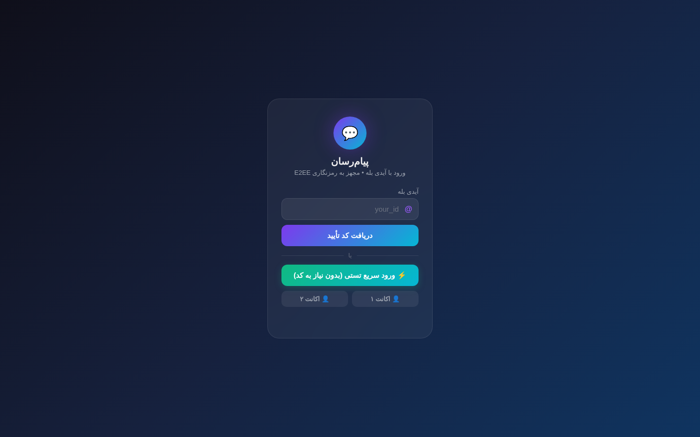
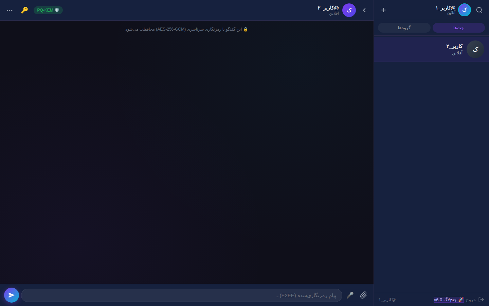
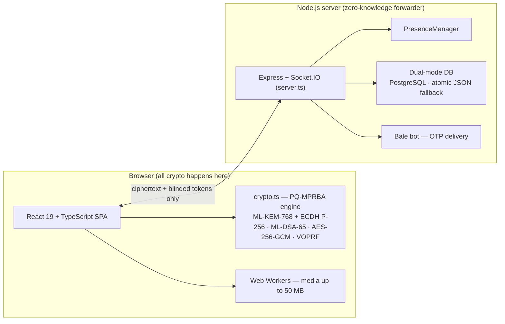

<div align="center">

# 💬 chat-app — Post-Quantum Encrypted Web Messenger

**A real-time Persian web messenger with end-to-end encryption built for the post-quantum era.**

Every message is protected by **PQ-MPRBA** — an original browser-native protocol combining a hybrid
**ML-KEM-768 (FIPS 203) + ECDH P-256** ratchet with **Ristretto255-VOPRF** blinded authentication (RFC 9497)
and **ML-DSA-65 (FIPS 204)** identity signatures.
The server never sees plaintext, and never learns who is talking to whom.

[](CHANGELOG.md)
[](https://react.dev)
[](https://www.typescriptlang.org)
[](https://expressjs.com)
[](https://socket.io)
[](#-the-pq-mprba-protocol)
[](https://github.com/indirect-b/chat-app/stargazers)

**🚀 Live demo:** https://chatapp-server-1i2a.onrender.com &nbsp;·&nbsp; use **⚡ Quick Test Login** — no sign-up needed
<br/><sub>(free-tier hosting: the first load may take ~30s while the server wakes up)</sub>

</div>

| Login — Bale ID + OTP, E2EE notice | Chat — PQ-KEM badge, AES-256-GCM thread |
| :---: | :---: |
|  |  |

---

## Why this exists

Most web messengers either skip end-to-end encryption entirely or bolt on a classical ECDH scheme
that a future quantum computer will retroactively break (*"store now, decrypt later"*).
chat-app was designed from the start for hostile networks and a post-quantum future:

- 🔐 **Post-quantum by design** — hybrid key exchange, so recorded traffic stays safe even against Shor's algorithm.
- 🙈 **Metadata-resistant** — blinded authentication means the server routes messages without linking identities.
- ⚡ **Built for unstable networks** — out-of-order message recovery, group key rotation that doesn't corrupt in-flight messages.
- 🧩 **Zero-knowledge server** — the backend is a forwarder of ciphertext, nothing more.

## ✨ Features

- Real-time direct & group messaging (Socket.IO, WebSocket + long-polling fallback)
- End-to-end encryption: **AES-256-GCM**, keys derived per message via a hybrid post-quantum ratchet
- Login with **Bale ID**: OTP codes delivered by a Bale bot (`src/server/bale.ts`), plus a 1-click quick test login
- Blinded identity authentication via **Ristretto255-VOPRF** with DLEQ zero-knowledge proofs
- **ML-DSA-65 identity signatures (FIPS 204)** — key bundles and session handshakes are signed and verified; the PQ-KEM badge appears only for verified hybrid post-quantum sessions, a classical fallback shows a warning banner, and a forged signature triggers a man-in-the-middle warning
- **Group Epoch FSM** — membership changes rotate group keys without losing in-flight messages
- Typing indicators, presence, reactions, message edit/delete/pin/forward, read receipts
- Voice notes & file attachments up to **50 MB**, processed off the main thread in Web Workers
- PBKDF2 room passphrases (100,000 iterations)
- Stealth admin dashboard at an obfuscated, server-side-only path (timing-safe auth)
- Dual-mode persistence: **PostgreSQL** when configured, otherwise an atomic, mutex-guarded JSON store
- Hybrid media storage so uploads survive container redeploys on Render / Railway / Docker

## 🔐 The PQ-MPRBA protocol

**PQ-MPRBA** *(Post-Quantum Multi-Party Ratchet with Blinded Authentication)* runs entirely in the
browser (`src/utils/crypto.ts`, Web Crypto API + `@noble/post-quantum` / `@noble/curves`).

**Layer 1 — Hybrid post-quantum ratchet.**
Each session combines **ML-KEM-768** (NIST FIPS 203, lattice-based) with classical **ECDH P-256**;
both shared secrets feed **HKDF-SHA256** into a symmetric ratchet chain. Every message gets a fresh
one-time **AES-256-GCM** key, giving forward secrecy and post-compromise recovery. Breaking a session
requires breaking *both* the lattice problem and the elliptic-curve problem.

**Out-of-order recovery.** If message #3 arrives before #2, the ratchet fast-forwards and caches the
skipped one-time keys in a bounded in-memory vault (`MAX_SKIP = 100` per room, 10-minute TTL).
Consumed keys and ML-KEM secrets are **zeroized in RAM** (`Uint8Array.fill(0)`) immediately after use.

**Layer 2 — Blinded authentication (Ristretto255-VOPRF, RFC 9497).**
The client blinds its identity scalar locally, the server evaluates it with its secret key and returns
a **DLEQ proof** (`POST /api/voprf/evaluate`), the client verifies the proof and unblinds the result to
derive an unlinkable routing token. The server can authenticate users without ever seeing — or linking —
their identities, replacing heavy RSA blind signatures with compact 32-byte group elements.

**Layer 3 — Post-quantum identity (ML-DSA-65, FIPS 204).**
Each user holds an ML-DSA-65 keypair alongside the ML-KEM/ECDH bundle. Key bundles and session
handshakes are signed with ML-DSA and verified on receipt, so a session's post-quantum claim is
authenticated, not just asserted. The UI enforces this: the 🛡️ PQ-KEM badge appears only when
ML-KEM-768 is present *and* the ML-DSA-65 signature verifies; a classical ECDH fallback shows a
⚠️ classical warning banner instead of the badge, and a forged signature raises a
⛔ man-in-the-middle warning.

**Group epochs.** Group keys rotate through a deterministic finite state machine
(`STABLE → ROTATING → STABLE`, synced via the `group-epoch-rotated` socket event). Outgoing messages
queue during rotation, and a 3-epoch grace buffer (`MAX_EPOCH_HISTORY = 3`) keeps messages sent
milliseconds before a membership change decryptable.

> ⚠️ **Honest status:** PQ-MPRBA is an original, experimental protocol written for this project.
> It has **not** been independently audited. Treat it as research-grade cryptography, not a
> replacement for audited messengers in high-risk situations.

## 🏗️ Architecture



| Layer | Technology |
| :--- | :--- |
| Frontend | React 19, TypeScript, Vite, modular RTL CSS (Vazirmatn) |
| Crypto | Web Crypto API, `@noble/post-quantum`, `@noble/curves`, Web Workers |
| Backend | Node.js, Express, Socket.IO, Helmet, CORS, express-rate-limit |
| Auth | Bale OTP bot + Ristretto255-VOPRF blinded tokens |
| Storage | PostgreSQL (`pg`) or atomic JSON fallback; hybrid `media_blobs` + disk |

Key engineering details:

- **Atomic disk fallback** (`src/server/db.ts`) — mutations are coalesced through a 250 ms debounced
write mutex and persisted via write-to-`.tmp` + atomic rename; history is auto-pruned at 5,000 messages.
- **Hybrid media persistence** — files ≤ 2 MB are stored as database blobs and served from
`GET /api/media/:id` with immutable caching; larger files (up to 50 MB) stream from disk, so media
survives ephemeral-container redeploys.
- **Cluster-ready presence** (`src/server/presence.ts`) — O(1) bidirectional `socketId ↔ username`
lookup, with `REDIS_URL` hooks for horizontal scaling.
- **No hardcoded secrets** (`src/server/config.ts`) — if `ADMIN_PASSWORD` is unset, a random
32-char hex secret is generated at boot; admin checks use `crypto.timingSafeEqual`, and the admin
path never appears in frontend bundles.

## 🚀 Quick start

**Prerequisites:** Node.js 18+ or 22+, npm 9+. PostgreSQL is optional.

```bash
git clone https://github.com/indirect-b/chat-app.git
cd chat-app
npm install
cp .env.example .env   # then fill in your secrets
npm run dev             # full-stack dev server (Express + Vite + Socket.IO)
```

Open http://localhost:3000 — use **Quick Test Login** to explore instantly, or log in with a Bale ID.
Production: `npm run build` then `npm start`.

### Environment variables

| Variable | Description |
| :--- | :--- |
| `PORT` | Server port (default `3000`) |
| `ADMIN_PASSWORD` | Admin secret (auto-generated at boot if empty) |
| `ADMIN_PATH` | Obfuscated admin dashboard path |
| `BALE_API` | Bale Bot API base URL |
| `BALE_BOT_TOKEN` | Bale bot token used to deliver OTP codes |
| `DATABASE_URL` | PostgreSQL connection string (empty = JSON fallback) |
| `REDIS_URL` | Redis URL for clustered presence (optional) |
| `STORAGE_MODE` | Media storage mode (`hybrid` recommended) |
| `MAX_FILE_SIZE` | Max upload size in bytes (default 50 MB) |
| `OTP_EXPIRE` | OTP validity window in seconds |

## 📂 Project structure

```text
server.ts                 # Express + Socket.IO server, media endpoints, Vite integration
src/
├── App.tsx               # Session, maintenance/blocked states, toasts
├── components/
│   ├── AuthScreen.tsx    # 3-step Bale OTP login + quick test login
│   └── ChatApp.tsx       # Messenger UI, key sync, voice recorder, modals
├── utils/crypto.ts       # PQ-MPRBA engine: hybrid ratchet, VOPRF, group epochs
└── server/
    ├── config.ts         # Hardened config, timing-safe admin verification
    ├── db.ts             # PostgreSQL pool + atomic JSON fallback
    ├── presence.ts       # Cluster-ready presence manager
    └── bale.ts           # Bale Bot API client (OTP delivery)
public/                   # Static assets, admin dashboard, modular CSS
data/database.json        # Auto-generated fallback database snapshot
```

## 🔌 API & realtime events

<details>
<summary><b>REST API</b></summary>

| Method | Endpoint | Description |
| :--- | :--- | :--- |
| `POST` | `/api/send-otp` | Generate a 6-digit OTP and send it via the Bale bot |
| `POST` | `/api/verify-otp` | Validate an OTP |
| `POST` | `/api/register` | Register a verified user |
| `POST` | `/api/quick-login` | Instant test login (auto-creates demo contacts) |
| `POST` | `/api/voprf/evaluate` | Evaluate a blinded Ristretto255 point, return a DLEQ proof (RFC 9497) |
| `GET` | `/api/user/:username` | Public profile + hybrid (ML-KEM-768 + P-256) public key |
| `POST` | `/api/user/public-key` | Publish a hybrid key bundle |
| `POST` | `/api/user/update` | Update bio, status, avatar |
| `GET` | `/api/contacts/:username` | Contacts with presence + public keys |
| `POST` | `/api/add-contact` | Add a contact by username |
| `GET` | `/api/messages/:roomId` | Messages of a direct/group room |
| `GET` | `/api/groups/:username` | Groups + current cryptographic epoch |
| `POST` | `/api/upload` | Hybrid upload (≤ 2 MB → DB blob, > 2 MB → disk) |
| `GET` | `/api/media/:id` | Serve a stored media blob |
| `POST` | `/api/report` | Report a message or user |
| `GET` | `/api/settings/mode` | Server mode (`normal` / `maintenance`) |
| `GET` | `/api/settings/rules` | Platform rules text |

</details>

<details>
<summary><b>Socket.IO events</b></summary>

- **Client → Server:** `auth`, `send-message`, `edit-message`, `delete-message`, `pin-message`, `react`, `forward-message`, `typing`, `read`, `update-status`, `update-location`
- **Server → Client:** `auth-ok`, `new-message`, `msg-edited`, `msg-deleted`, `msg-pinned`, `msg-reaction`, `typing`, `read`, `contact-online`, `contact-offline`, `contact-status`, `peer-key-updated`, `new-group`, `group-epoch-rotated`, `blocked`, `kicked`, `server-maintenance`, `server-normal`, `announcement`

</details>

## 📋 Version history

Full details in [CHANGELOG.md](CHANGELOG.md).

- **Latest (Oct 2026)** — ML-DSA-65 identity signatures (FIPS 204), anti-silent-downgrade indicators (verified-PQ badge gating, classical-fallback warning, forged-signature alert)
- **v6.0** — PQ-MPRBA: hybrid ML-KEM-768 + ECDH P-256 ratchet, Ristretto255-VOPRF blinded auth, Group Epoch FSM
- **v5.0** — Automatic ECDH P-256 key exchange & public-key directory
- **v4.0** — Non-blocking atomic disk fallback (debounced mutex, `.tmp` rename)
- **v3.0** — Hybrid cloud-safe media storage (`media_blobs`)
- **v2.0** — Cluster-ready presence service
- **v1.0** — Admin & environment security hardening

---

## 🇮🇷 درباره پروژه (فارسی)

**پیام‌رسان** یک پیام‌رسان تحت وب فارسی و بلادرنگ است که تمام پیام‌هایش با رمزنگاری سرتاسری
**پساکوانتومی** محافظت می‌شود. پروتکل اختصاصی پروژه، **PQ-MPRBA**، ترکیبی از تبادل کلید هیبریدی
**ML-KEM-768 + ECDH P-256** و احراز هویت کور **Ristretto255-VOPRF** است و هویت‌ها با امضای **ML-DSA-65** تأیید می‌شوند؛ یعنی سرور نه متن پیام‌ها
را می‌بیند و نه می‌تواند هویت کاربران را به هم گره بزند. ورود با آیدی بله (کد تأیید از طریق ربات بله)
انجام می‌شود و برای تست، ورود سریع بدون کد هم وجود دارد.

**اجرای سریع:** `npm install` ← ساخت فایل `.env` از روی `.env.example` ← `npm run dev`

---

<div align="center">

Built by [Mohammad Taha Azizi Ahad](https://github.com/indirect-b) — feedback, issues and stars are welcome ⭐

</div>
